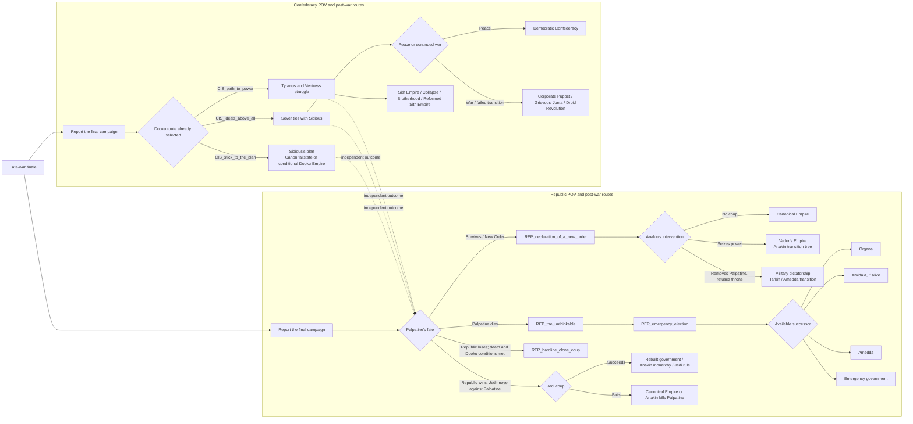

# Episode III Event Plan

## Purpose and entry point

Episode III is the event bridge from the Clone Wars into the Republic and CIS post-war focus routes. It is not a single linear retelling that forces Order 66. The sequence must read the political and Dooku choices already made, present both countries with their own perspective, and end on the post-war outcome those choices support.

Start the finale from a late-war resolution point in the campaign or the appropriate endgame focus. Do not start it a fixed number of days after Episode II: the war is played through operations, and a calendar timer can fire before the campaign reaches its finale.

Use regular country events only. Keep the event arc separate from the focus-tree content: events establish the outcome flags and tell the story; the matching focus trees provide the longer post-war gameplay.

## Flow at a glance

## Inputs carried into Episode III

The event chain reads, rather than duplicates, these campaign decisions:

- **Republic approach:** soft-line or hardline route. Preserve this from Episode II and the Republic tree.
- **Amidala's fate:** the soft-line route can allow her assassination; the player can still choose the foiled attempt. Her later chancellorship is available only if she survived.
- **CIS strategy:** use the mutually exclusive Dooku route selected after `CIS_dookus_dilemma`:
  - `CIS_stick_to_the_plan` — Dooku follows Sidious's plan.
  - `CIS_ideals_above_all` — Dooku tries to free the CIS from Sidious and pursue a more legitimate state.
  - `CIS_path_to_power` — Dooku pursues his own Sith power base.
- **War result and leaders' status:** record who won or lost, whether Palpatine lives, and whether Dooku is alive, independent, or deposed. These decide which post-war tree entries are coherent.

## Shared finale event structure

### 1. The last phase of the war

The Republic and CIS each receive a country event about the final campaign. The events can be scheduled together, but neither country's progress depends on the other player responding. A player can make their own final decisions while the opposing side is AI or another player.

### 2. Dooku and Sidious

The CIS event reflects the route already chosen in the CIS tree; it should not ask Dooku to choose the same path a second time.

- **Dooku follows the plan (`CIS_stick_to_the_plan`):** the Confederacy remains Sidious's instrument. If the plan succeeds, proceed to the canonical Imperial transition. Preserve the CIS plan's possibility that a capable Dooku turns on Sidious and creates Dooku's Galactic Empire; this requires a successful assassination/outmaneuvering of Sidious and must not be a free automatic win.
- **Dooku seeks independence (`CIS_ideals_above_all`):** Dooku works to sever ties with Sidious. The CIS receives a meaningful choice between `CIS_peace_finds_a_way` and `CIS_the_war_rages_on`. Success can lead toward the Democratic Confederacy; failure can leave the war active or open the Corporate Puppet, Grievous' Junta, or secret Droid Revolution branches described in `CIS_Plan.txt`.
- **Dooku seeks Sith power (`CIS_path_to_power`):** show the Sith power struggle and his attempt to build a new order outside the Rule of Two. Later outcomes follow the CIS plan: Sith Empire if he controls the movement, Collapse if the Tyranus/Ventress balance breaks, or Ventress's Brotherhood of Darkness/Reformed Sith Empire routes if she takes control.

The Republic receives its own events about the Separatist leadership and the consequences of each CIS choice. It never receives the CIS player's decision popup.

### 3. Palpatine's ritual and fate

Resolve the ritual and Palpatine's fate through the event chain, using the CIS strategy and the Republic's established route as context.

- **Palpatine ends the ritual / survives:** continue the Canon Empire route in the Republic post-war design, beginning with `REP_declaration_of_a_new_order`. The CIS result still depends on Dooku's selected path and the CIS player's decisions.
- **Palpatine dies in the ritual or is killed:** begin the Republic's Palpatine-death route with `REP_the_unthinkable`, followed by mourning, the emergency election, and the appropriate chancellor/government branch.
- **Anakin intervenes:** make this a pivotal player choice where the existing Empire plan supports it. Anakin may kill Palpatine and seize power, kill him and leave the military to take over, or refuse the coup. Do not collapse these into one generic “Empire formed” result.

### 4. Republic outcome and post-war focus handoff

The Republic event reports the war result and Palpatine's fate, then points to the corresponding branch in `HOD_REP_Post_War_Tree.txt` and the supplied Republic diagrams.

- **Palpatine is dead:** `REP_the_unthinkable` leads to `REP_emergency_election`. The election can lead to Chancellor Organa, Chancellor Amidala (only if the Episode II assassination did not happen), Chancellor Amedda, or `REP_emergency_government`.
- **Republic loses and Palpatine is dead:** make the clone-coup entry available only when the diagram's conditions are met, including Dooku dead/deposed and independent where required. The `REP_hardline_clone_coup` tree then carries the clone-government and Mandoade branches.
- **Republic wins and the Jedi move against Palpatine:** branch on whether the Jedi coup succeeds. A successful coup can hand power to a rebuilt government, make Anakin a constitutional monarch, or put the Jedi in control. A failed coup can restore the canonical Empire or allow Anakin to kill Palpatine, following the supplied Republic plan.
- **Palpatine survives and declares the New Order:** continue `REP_declaration_of_a_new_order` and its imperial branch. The Episode III events should not prematurely play out the Empire's later consolidation content.
- **Clone-rights decision:** where the Republic plan reaches the clone-rights issue, give the Republic player a distinct full-rights/no-rights decision and connect its result to the planned clone-coup outcome. Keep this distinct from the CIS player's choices.

### 5. Empire succession and Anakin's tree

If Anakin takes power early, route to the **Vader's Empire** concept in `Empire_Path.txt` and the supplied Anakin diagram. The transition events should lead into:

1. The Duel of Fates and handling the transition.
2. An Anakin decision across Peace, Freedom, Justice, or Security.
3. My New Empire, then the choice between Cleaning Up the Scum and the War of Liberation.
4. My New Order, with the later Kill the Past or Redemption in Darkness split and the linked people/family and ruler-style outcomes.

If Anakin removes Palpatine but refuses the throne, or Palpatine dies by another route, use the **Military Dictatorship** transition: a provisional military or civilian authority under a figure such as Tarkin or Mas Amedda, with the possibility of fragmentation or a later successor. The **Sane Empire** is a long-term umbrella for reformist or pragmatically governed imperial paths, not an instant event that erases the transition crisis.

## Confederacy post-war handoff

The CIS event chain ends by preserving the selected route and opening the matching CIS focus-tree content. Use `CIS_dookus_dilemma` and its mutually exclusive paths as the route source; use `CIS_Plan.txt` for the eventual endpoint and mechanics.

| CIS route | Event resolution | Planned endpoint |
| --- | --- | --- |
| Stick to the plan | Sidious's scheme succeeds, or a sufficiently strong Dooku outmaneuvers Sidious | Canonical CIS failstate, with the conditional Dooku's Galactic Empire possibility |
| Ideals above all | Dooku severs ties with Sidious; peace or continued war is resolved | Democratic Confederacy, or failure branches to Corporate Puppet, Grievous' Junta, or Droid Revolution |
| Path to power | Dooku builds a Sith power base; resolve Tyranus/Ventress balance | Sith Empire, Collapse, Brotherhood of Darkness, or Reformed Sith Empire |

Do not make the CIS's episode-ending event only a reaction to the Republic's result. Give the CIS player control over the CIS choice and a matching event for every major Republic transition.

## Multiplayer and AI rules

- Every major Episode III beat has a Republic event and a CIS event. Anakin-specific decisions belong to the Republic; Dooku/Ventress-specific decisions belong to the CIS.
- A human player's event never chooses for the opposing human. The opponent sees a separate report and makes their own decision.
- No chain waits for both tags to click. Resolve cross-country consequences from the saved route flags and current war/leader state, with safe fallbacks if the other side is AI or a country is no longer controlled by its original tag.
- AI follows its already selected focus route. Where the plan offers a new decision, use explicit `ai_chance` weights that match the route; do not use an unscoped random list that can send an event to the wrong country.
- Non-canonical outcomes remain playable and lead to their planned focus branches. They should not silently snap back to the canonical Empire.
- Keep war declaration, peace, and territorial changes in the existing operation or focus effects. Story events should not duplicate them.

## Integration checklist for implementation

1. Record Republic soft-line/hardline, Amidala alive/dead, CIS Dooku route, Palpatine fate, Dooku status, and war result as persistent flags or equivalent state.
2. Gate `REP_chancellor_amidala` on Amidala's survival.
3. Send a Republic and CIS event for each shared turning point, with the owning country making the choice.
4. Route each ending to the matching Republic/CIS focus-tree entry without reopening a decision already made in the tree.
5. Keep the sequence playable in Republic-human/CIS-AI, CIS-human/Republic-AI, and human-versus-human games.
