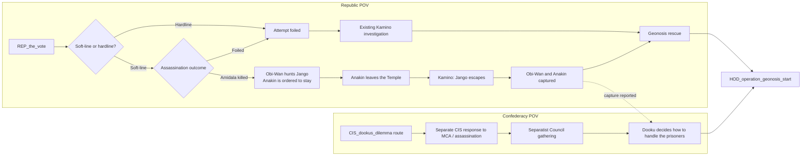

# Episode II Event Plan

## Purpose

Make Attack of the Clones a two-sided playable event sequence that starts from the Republic's Military Creation Act (MCA) vote and can lead into the Geonosis operation. This plan uses ordinary country events only. It is a story and implementation plan; it does not replace the existing Republic or CIS focus trees.

The event chain must read the Republic's earlier soft-line or hardline choice. The successful Amidala assassination is available only on the soft-line route. It is an alternate outcome the player can choose, not a consequence forced by being pacifist. The hardline route gets the failed-attempt investigation path.

## Flow at a glance

## Republic route

The Republic's existing `REP_the_vote` focus is the entry point. Its event should branch on the political route recorded by the Republic tree.

### Soft-line route: Amidala assassination is possible

1. **The MCA Vote and the Attempt** — Give the Republic player the choice to have the assassination succeed or be foiled. The AI can select either outcome, weighted toward the story path configured for the campaign. The successful result sets a persistent Amidala-dead flag for later focus-tree eligibility.
2. **The Senator Is Dead** — Obi-Wan is tasked with finding the assassin. Anakin is ordered to stay at the Jedi Temple. Start the Republic POV events for Obi-Wan and Anakin, and send the CIS its own reaction event.
3. **Obi-Wan Pursues Jango Fett** — Obi-Wan follows the bounty hunter's trail to Kamino.
4. **Anakin Leaves the Temple** — Anakin disobeys his order and goes after Obi-Wan.
5. **The Meeting on Kamino** — Anakin's intervention lets Jango escape. Obi-Wan rebukes Anakin; the trail points to Geonosis.
6. **Captured on Geonosis** — Obi-Wan and Anakin are captured while investigating the Separatist gathering. Send a separate CIS event about Dooku's prisoners.
7. **The Arena and the First Battle** — The CIS decision at Geonosis and the Republic's rescue attempt lead into `HOD_operation_geonosis_start`. The operation, rather than the story popup, declares and runs the war.

### Hardline route: assassination is foiled

1. **The Failed Attempt** — The assassin fails. Send the Republic down its existing Obi-Wan investigation to Kamino and send the CIS a parallel event about the Republic's response.
2. Continue through the existing investigation, capture, Dooku, and Geonosis events. Both tags get their own event perspective at the key transitions.
3. Start the same Geonosis operation when the arena rescue begins.

The two branches can converge on Geonosis without pretending that the Republic chose the same political response. A soft-line campaign may also choose the foiled outcome; it simply has the assassination option available.

## Confederacy route

The CIS must receive playable events alongside the Republic at each shared beat. CIS events use a CIS namespace and are not REP popups sent to the other country.

1. **The Separatist Council** — The CIS receives its own MCA and assassination news. Dooku's response follows the CIS path selected through `CIS_dookus_dilemma`:
   - `CIS_stick_to_the_plan`: Sidious's plan; keep the corporate leaders aligned and prepare the Geonosis trap.
   - `CIS_ideals_above_all`: Dooku's independent, reformist intentions; offer a path toward peace, but preserve the option to continue the war through `CIS_the_war_rages_on`.
   - `CIS_path_to_power`: Dooku's Sith ambitions; prepare to use the crisis to build his own power.
2. **The Separatist Gathering** — This is the CIS POV counterpart to the Republic investigation. It may lead toward the arena regardless of which Republic assassination outcome occurred.
3. **Dooku's Prisoners** — When the Republic capture event fires, the CIS player receives a choice about how Dooku handles the prisoners. That choice affects the story branch, but it must not wait for a Republic player to click an event before the CIS can act.
4. **Battle of Geonosis** — The CIS receives a matching battle-start event as the Republic begins its rescue. The existing operation owns the war declaration and battlefield setup.

The CIS route should not be reduced to receiving a notification after Republic events. It needs its own choices and consequences, including the possibility that an independent Dooku pursues peace or turns against Sidious.

## Multiplayer and AI behavior

- Each country receives its own event and makes its own decisions. A human Republic and a human CIS player can choose independently; no chain waits for both players to answer.
- Cross-country events communicate the other side's action. They do not make decisions on behalf of the other country.
- AI choices should follow the corresponding focus-tree route. If no route flag is set, use a documented AI weight; never rely on a random event being delivered to whichever tag happens to receive it.
- If the other tag is AI, its event resolves through normal AI option weights. The human player's chain continues on its own schedule.
- Shared war-state changes happen once, through the operation start effect. Character outcomes and story branches use scoped flags so simultaneous Republic and CIS popups cannot start the operation twice.
- Every choice has a safe continuation. A non-canonical choice should lead to a defined branch or rejoin point, not a dangling event.

## Carry-over to the post-war trees

- Preserve the soft-line/hardline choice as a Republic route flag.
- Preserve whether Amidala was assassinated. If she was, the later `REP_chancellor_amidala` route must be unavailable; the event plan must not resurrect her as a post-war candidate.
- Preserve the CIS Dooku route so Episode III can branch into the existing `CIS_stick_to_the_plan`, `CIS_ideals_above_all`, or `CIS_path_to_power` outcomes.
- The Episode II event chain ends at the war's opening. It does not jump ahead to Episode III or impose a fixed multi-year timer.
